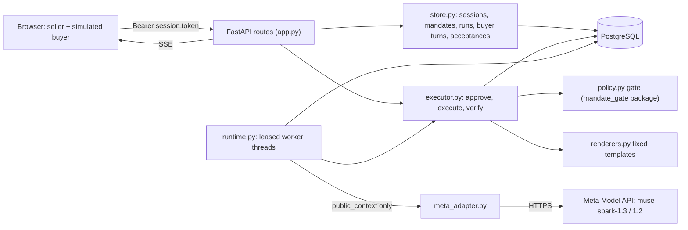

# Architecture

One container: FastAPI serves the API and the built web app; in-process worker threads run agent steps; PostgreSQL holds all state. In the default deployment the database is an embedded PostgreSQL 16 inside the single instance; set `DATABASE_URL` to use a managed PostgreSQL instead.

## Request paths

1. **Buyer message.** `POST /v1/runs/{id}/buyer-turns` stores the text as untrusted input, runs the deterministic risk scanner, appends an audit event and sets `runs.needs_step`. No model call happens in the request.
2. **Agent step.** A worker claims the run (`FOR UPDATE SKIP LOCKED`, lease 300 s, `fence = fence + 1`). It builds the public context (Appendix B of `POLICY.md`), calls the model with no transaction open, persists the proposal as an immutable action (canonical body and hash), then calls `executor.execute(action, fence)`.
3. **Execute.** One transaction: lock the mandate row, then the listing row, then the run. Return the stored result if an operation already exists. Reload the mandate, expire it if due, build fresh snapshots, run all gate checks. Deny or invalid: record the decision and a safe feedback code for the model. Approval required: create a pending approval bound to the hash. Allow: render the template, write the message/offer or reservation and the operation row, append events, commit.
4. **Approval.** `POST /v1/approvals/{id}/resolve` approves and executes in the same locked transaction, so revocation and approval are strictly ordered. The verifier then reads the reservation back.
5. **Owner controls.** Pause, revoke, edit and activate take the mandate lock. Revoke cancels pending approvals and runs in the same transaction.

## Why each piece exists

| Piece | Property it protects |
| --- | --- |
| Lock order mandates → listings → runs → sessions | Revocation and the final effect cannot interleave; no deadlocks |
| Fence token checked inside the effect transaction | A worker whose lease was taken over cannot commit |
| `needs_step` cleared only if no newer buyer event | New buyer input is never dropped |
| Unique `operations.action_id`, unique `source_operation_id`, partial unique index on active reservation per item | At most one effect per action and one active reservation per item, even under races |
| Canonical action hash stored at proposal time | The owner approves exactly what will run; the stored body is re-hashed at execution |
| Reconciliation on `OperationalError` | An unknown commit outcome is resolved by operation identity, never by blind retry |
| Projections built from explicit field lists | Private seller data is never selected for buyer or model views |

## States

Run: `created`, `running`, `awaiting_buyer`, `waiting_approval`, `paused`, `blocked`, `completed`, `failed`, `cancelled`. `awaiting_buyer` is an addition to the spec's list for an idle negotiation. Action: `proposed`, `invalid`, `denied`, `waiting_approval`, `succeeded`, `failed`, `cancelled`, `no_action` (plus `authorized`, `executing`, `unknown` reserved in the schema). Gate verdict and receipt verdict are separate fields.

## Connector seam

The marketplace sandbox is local tables written in the same transaction as the gate check. A real marketplace connector would need its own idempotency key, readback and an `unknown` state, and could not share this transaction. That is future work and is not claimed.

## Buyer channels

`services/api/delegate/channels/` is the seam between where buyers talk and the negotiation. The in-app buyer simulator is the default channel. A WhatsApp Business Cloud API adapter (`whatsapp.py`, `service.py`, migration `0007_channels.sql`) is implemented and fixture-tested but **off by default** (`DELEGATE_WHATSAPP_ENABLED=0`) and not connected to a live business number:

- `GET /v1/channels/whatsapp/webhook` answers Meta's subscription check only with the configured verify token.
- `POST /v1/channels/whatsapp/webhook` requires a valid `X-Hub-Signature-256` (HMAC-SHA256 of the raw body with the app secret), records each message ID once (redeliveries and replays are dropped), refuses messages older than an hour, and feeds text from a bound buyer into the same `buyer_turn` path as the simulator: untrusted input to the same gate.
- `POST /v1/runs/{id}/channel-binding` (owner only) ties one WhatsApp ID to one negotiation.
- A delivery loop sends only seller messages the server rendered from fixed templates, only to the bound buyer, and only within 24 hours of the buyer's last message; outside the window it records `outside_window` and sends nothing.
- Approval never travels over the channel: the seller approves the exact reservation in the console.

Tests: `tests/integration/test_whatsapp_channel.py` (synthetic payloads in Meta's documented shapes; outbound to a fake transport).
